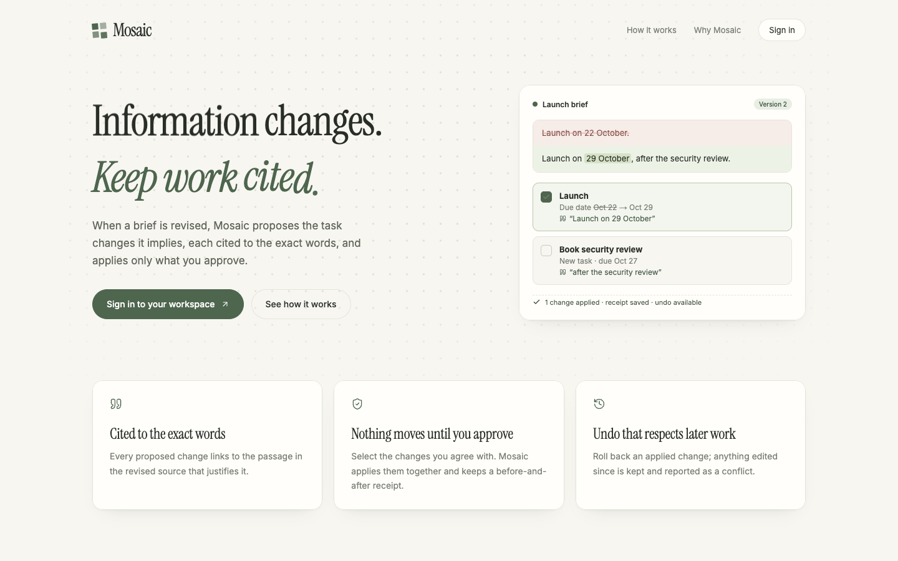
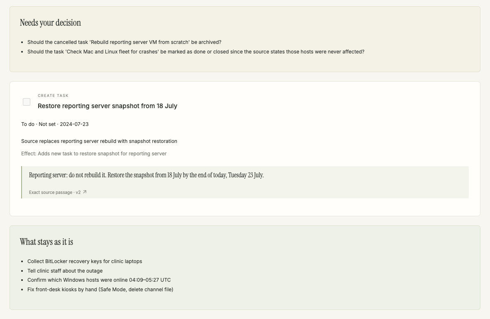
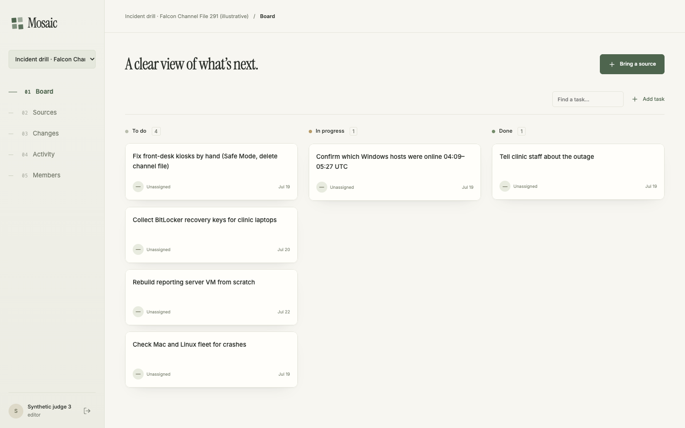

# Mosaic

**When a brief changes, Mosaic shows exactly which tasks it changes, cites the words that justify each change, and applies only what you approve.**

[](https://github.com/Ololadestephen/Mosaic/actions/workflows/checks.yml)
[](https://github.com/Ololadestephen/Mosaic/actions/workflows/testsprite-pr.yml)
[](https://github.com/Ololadestephen/Mosaic/actions/workflows/testsprite-api.yml)

`31 TestSprite App checks on every PR` · `4 pinned strict TestSprite cases (required)` · `4 TestSprite API tests against production` · `179 unit` · `73 PostgreSQL` · `23 browser`

[Live app](https://trymosaic.vercel.app) · [How it works](#how-it-works) · [Testing](docs/testing.md) · [AI and limits](docs/ai.md) · [Operations](docs/operations.md)



## Why

Plans are written against a brief, a policy or an incident report. When that source is revised, someone has to work out which tasks it now contradicts, and that work is usually done from memory. Tasks quietly go stale, cancelled work gets marked done, and nobody can say why a date moved.

Mosaic keeps every revision of a source, compares it with the one before, and proposes the task changes the new wording implies. Each proposal quotes the exact passage it relies on. Nothing changes until a person selects it, and every applied change can be undone without overwriting work done since.

## How it works

1. **Bring a source.** Paste a brief and keep adding revisions. Each revision is immutable, and a revision names the one it replaces.
2. **Review the change.** Compare the two versions side by side and read the proposals: status, assignee and due-date updates, new tasks, and open questions. Each one links to the exact quoted passage.
3. **Apply what you choose.** Selected proposals are applied together in one transaction, and a receipt records every field before and after.
4. **Undo safely.** Undo restores only the fields nobody has edited since. Anything changed later is kept and reported as a conflict.



_From the bundled incident drill: the revised brief says "do not rebuild" the reporting server. Mosaic proposes the replacement task, asks whether to archive the cancelled one, and does not mark it done._

## Features

- **Cited proposals.** The server checks that every quotation exists in the selected revision and derives its exact offsets; an invented quote is rejected.
- **Human approval.** The model can only propose. Deterministic server code validates and performs every write.
- **Conflict-aware undo.** Field-level lineage means undo never overwrites a later edit.
- **Source history.** Immutable revisions with side-by-side comparison, and evidence links from each task.
- **Workspaces and roles.** Isolated workspaces with owner, editor and viewer access and private sources.
- **Durable activity.** An execution journal with idempotent apply and undo that survive refreshes and retries.



## Try it

The hosted app is at **[trymosaic.vercel.app](https://trymosaic.vercel.app)**. Registration there is closed. Hackathon judges receive a private lobby link: picking a seat signs you into that seat's synthetic workspaces, including the incident drill shown above, with a small allowance of live analyses. [Operations](docs/operations.md#judge-access) explains how access works.

To run it yourself, see [Getting started](#getting-started).

## Tech stack

| Layer     | Choice                                                                                                   |
| --------- | -------------------------------------------------------------------------------------------------------- |
| App       | Next.js 16 (App Router), React 19, TypeScript                                                            |
| Data      | PostgreSQL ([Neon](https://neon.tech) in production), checksummed SQL migrations, `postgres.js`          |
| AI        | Google Gemini (`gemini-3.5-flash-lite`), server-side only, behind strict validation                      |
| Contracts | `zod` schemas at every boundary                                                                          |
| UI        | Hand-written CSS, `lucide-react` icons, `motion`, adapted [React Bits](https://reactbits.dev) components |
| Testing   | Vitest, Playwright, real PostgreSQL, [TestSprite](https://www.testsprite.com) (UI, API and GitHub App)   |
| Hosting   | Vercel; deploys only `main` and one provisioned preview branch                                           |

## Getting started

You need Node.js 24 and npm.

```sh
npm ci
npm run local:db   # starts a local PostgreSQL, applies migrations; keep it running
npm run dev        # in a second terminal
```

Open http://localhost:3000, create an account and a workspace, and use **Bring a source** to try the bundled fictional brief. Collaborators register their own accounts; an owner can then add them by email as editors or viewers.

Copy variable names from `.env.example` and put values only in local env files or hosting secrets. Live analysis is off unless you configure a provider; see [AI and limits](docs/ai.md).

## Testing

```sh
npm run format:check && npm run lint && npm run typecheck
npm test              # unit + integration (start npm run local:db first)
npm run test:e2e      # browser tests on a separate local server and test database
npm run build && npm run check:package
```

| Layer                                   | What it covers                                                                                                                  | Where it runs                       |
| --------------------------------------- | ------------------------------------------------------------------------------------------------------------------------------- | ----------------------------------- |
| Unit                                    | Contracts, citation and proposal validation, prompts, provider failure handling (mocked HTTP)                                   | Every PR                            |
| Integration                             | Real PostgreSQL: locking, permissions, idempotency, rollback, the production runtime role's privileges                          | Every PR                            |
| Browser                                 | Full lifecycle with labelled fixtures: review → apply → refresh → undo with a conflict                                          | Every PR                            |
| TestSprite strict suite (required)      | Four pinned scripts against the exact PR preview, including the stateful apply/undo fixture                                     | Every PR, blocks merge              |
| TestSprite GitHub App (`TestSprite V3`) | 31 checks: public pages and access boundaries, plus signed-in board, sources, review and viewer limits (not pinned to a commit) | Every PR preview deployment         |
| TestSprite API                          | Health and headers, origin guard, signed-out rejection, sign-in validation and rate limits                                      | Production, every merge and nightly |

`main` is protected: the four required checks must pass and admins cannot bypass them. The [testing guide](docs/testing.md) explains how each suite proves it ran the reviewed code against the right commit.

## Project layout

```
src/app/            routes and pages
src/components/     UI, including adapted React Bits components in components/bits
src/domain/         pure contracts and validation (no I/O)
src/server/         database, auth, reconciliation, AI providers
migrations/         SQL migrations with checksums
tests/              unit, integration, e2e and TestSprite API tests
scripts/            local database, access links, publication checks, TestSprite tooling
```

## Limitations

- Live AI quality has been checked on a few real runs of one scenario; that is not evidence of broad model reliability. Fixtures and mocks test the application, not the model.
- Sources are plain text. There is no email verification, password recovery or invitation email.
- Tasks have three editable fields (status, assignee and due date) and no "cancelled" state; a cancelled task becomes an archive question.
- Hosted analysis is deliberately capped per account and per day.
